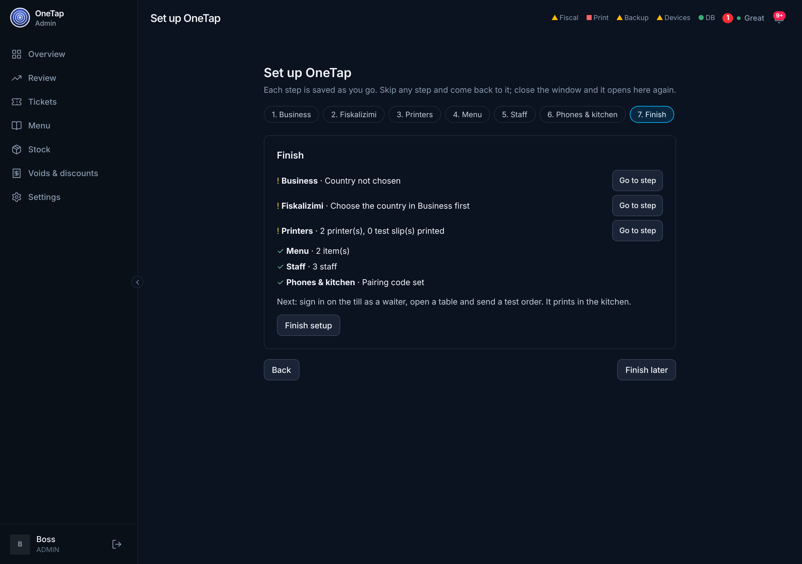
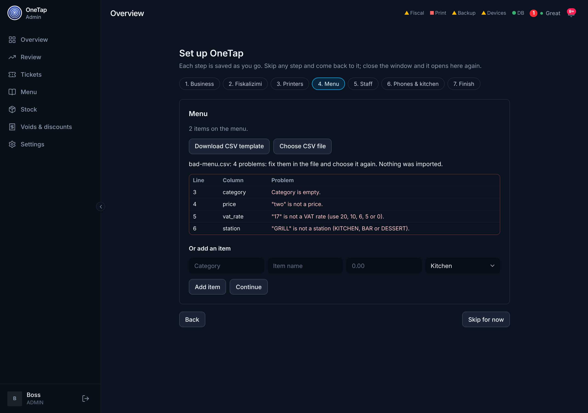
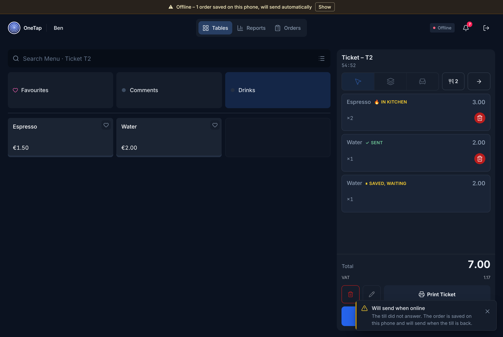
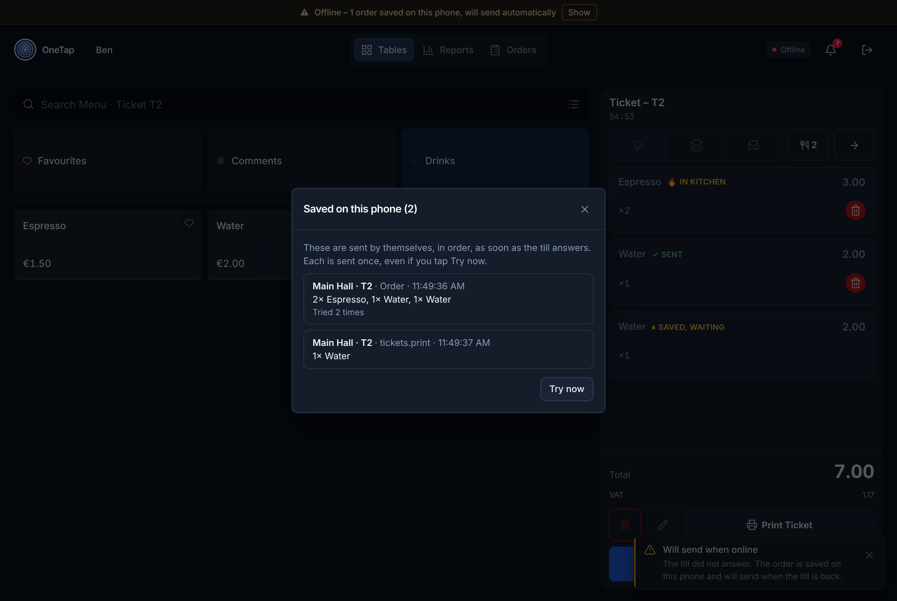
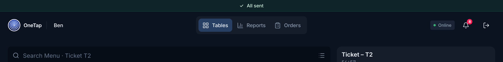
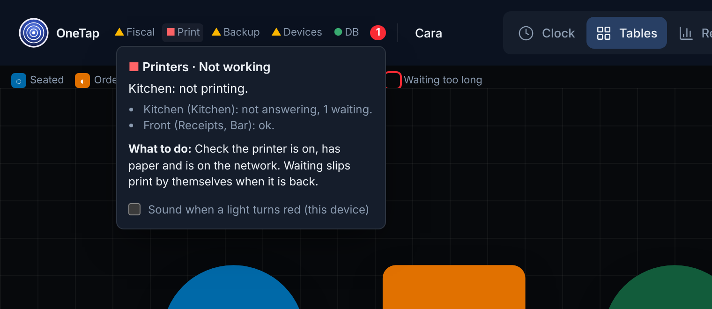
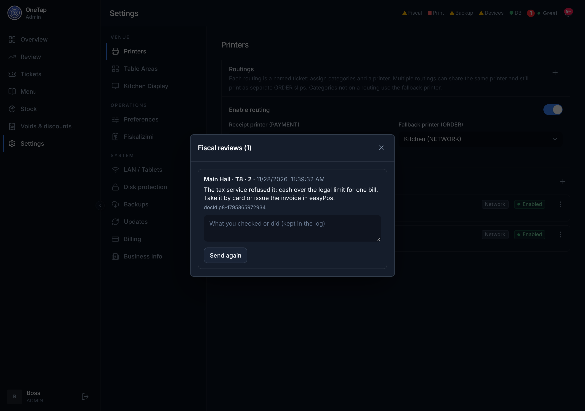
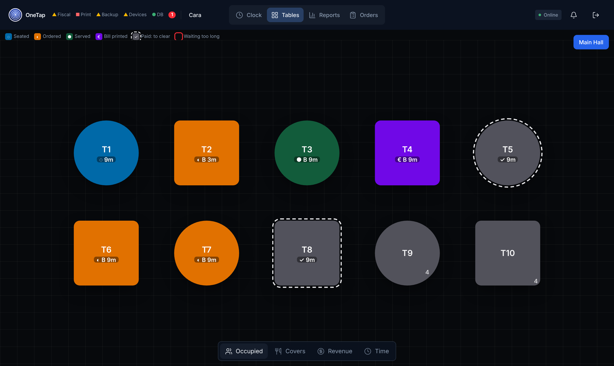
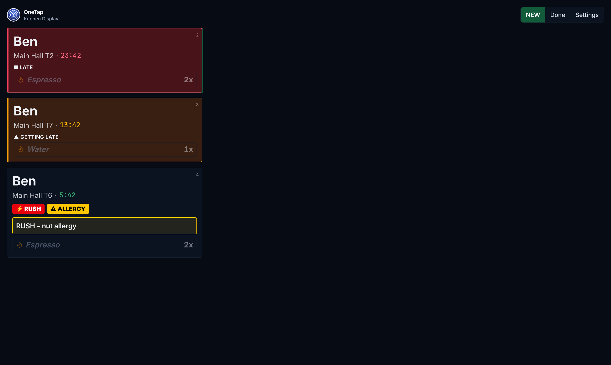

### Setup wizard
OneTap Admin opens a step-by-step setup the first time it signs in to a till with no business set up. It can be reopened from Settings › Updates › Setup wizard. Each step is saved as you go: skip any step and come back to it, and if the window is closed it reopens at the same step.
1. **Business:** name, address, country (Albania or UK), currency and NIPT/VAT number. Each field has a clear error.
2. **Fiskalizimi (Albania):** connects only to the easyPos DEMO (test) service and tests the connection. A live address can't be saved from setup.
3. **Printers:** finds printers on the Wi-Fi or adds one by address and port, and prints a test slip for each station (receipts, kitchen, bar, desserts).
4. **Menu:** add items by hand, or import a CSV from the downloadable template. Every problem is listed by line and column, and nothing is imported until the file is clean.
5. **Staff:** admins and waiters, with their PIN and role.
6. **Phones & kitchen:** the till's address with a QR code, and the pairing code for the Waiter app and KDS.
7. **Finish:** a checklist of what is done and what is missing, with a link to each step.

### Order line states and the offline bar (Waiter app and web waiter)
- Each line shows where it is: **Not sent**, **Saved, waiting** (the till was out of reach), **Sending**, **Sent**, **In kitchen** (on the KDS) or **Done** (bumped). Each state has an icon and a word as well as a colour. Tap a state to see what it means.
- When the till can't be reached, a calm amber bar says "Offline – N orders saved on this phone, will send automatically". When the till is back it shows "Sending…", then a brief green "All sent". It only appears after several missed checks in a row, never while requests are still getting through.
- **Show** lists what is waiting: tables, items, time and attempts. The list survives a restart of the app. "Try now" asks the queue to send; each order is sent once, under the code it was saved with.

### Status lights and fiscal reviews
- The till header (and phones signed in as admin or cashier) shows five lights: **Fiscal, Printers, Backup, Devices, Database**. Each is ● OK, ▲ needs attention or ■ not working. The till checks printers and easyPos over the network every 10 seconds while someone is looking, so a light changes within about 10 seconds. Tap a light for the message, the details (per printer, per device) and what to do. An optional sound plays when a light turns red (set per device).
- A red badge counts the sales waiting for a fiscal review. In OneTap Admin it opens the list, with each sale's reason in plain words and a guided fix: send again; look the sale up in easyPos and enter its codes or confirm it's not there; or mark a correction as done. Every decision needs a short note and is kept in the security log with who made it.

### Table colours and timers, KDS ticket age
- **Floor plan** (till, Waiter app, web waiter): tables are coloured by state: seated, ordered, served, bill printed, or paid and still to clear (dashed outline). Each table shows an icon, the waiter's initials and the time since the last order. A table waiting longer than the venue's limit (30 minutes by default) gets a red ring. A legend sits above the floor, and the states read without colour.
- **Kitchen display:** tickets turn amber after 8 minutes and red after 15 by default. The whole card changes colour, with the words "Getting late" or "Late", and the elapsed time is always shown. Notes asking for speed ("rush", "urgent", "shpejt") or mentioning an allergy ("allergy", "gluten", "nuts", "alergji"…) get big **RUSH** and **ALLERGY** flags. Optional sounds for new and rush tickets.
- All the times and sounds are set per venue in Admin › Settings › Kitchen display › Timing and colours. Open screens pick up a change within seconds, without a restart.

### Notes
- Payments, fiskalizimi and duplicate protection (one payment and one invoice per payment code) are unchanged.
- Line "In kitchen" and "Done" states need the kitchen display. Lines that go to no display show "Sent".
